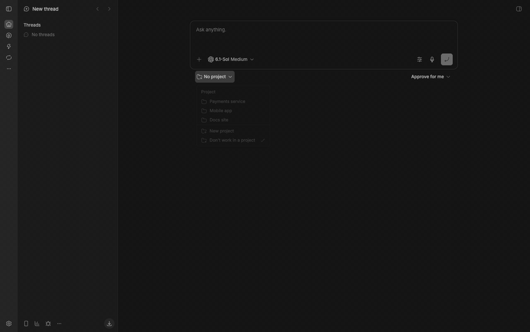
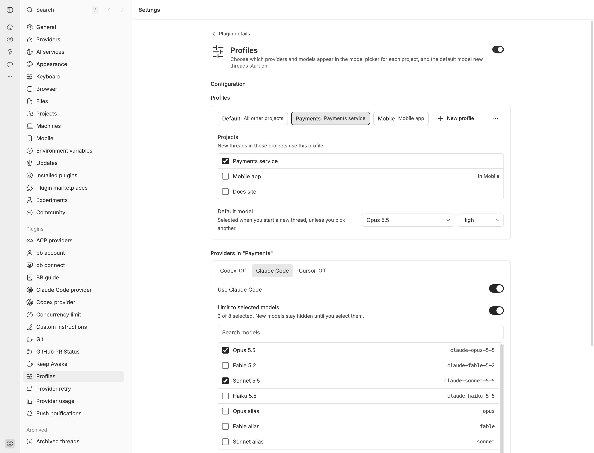
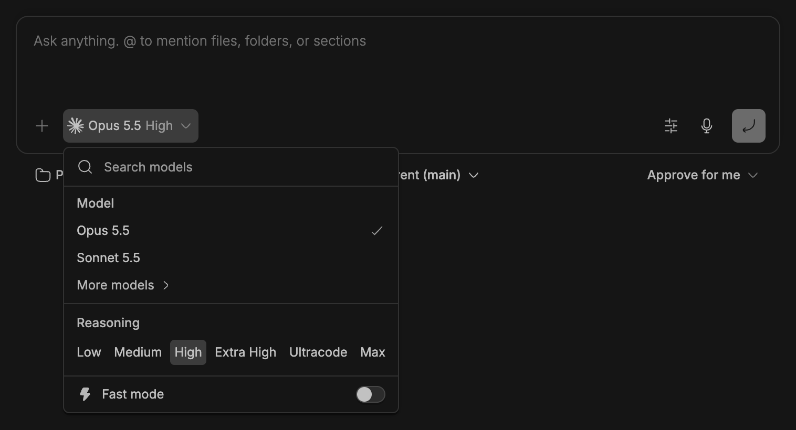
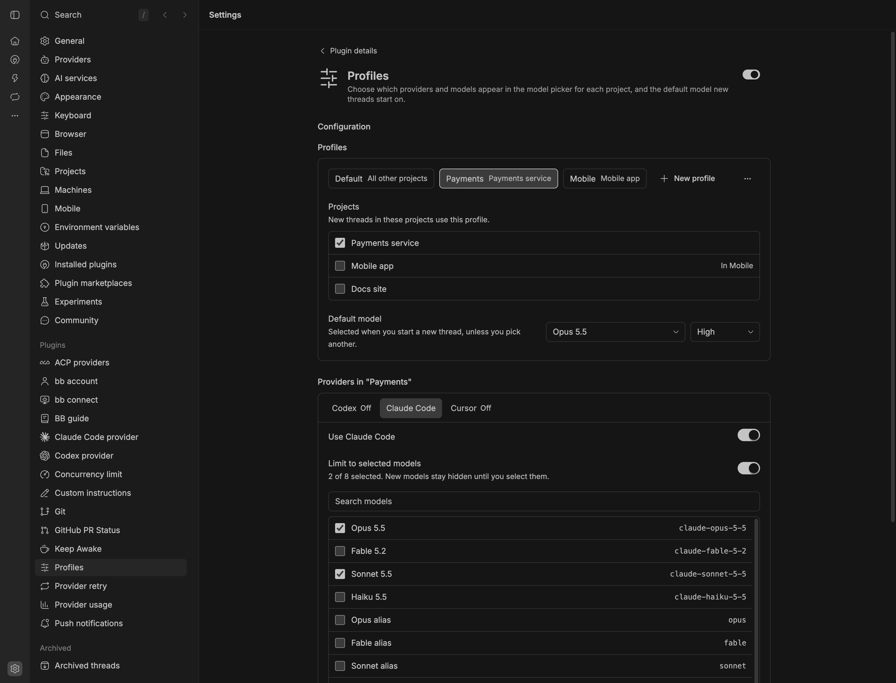
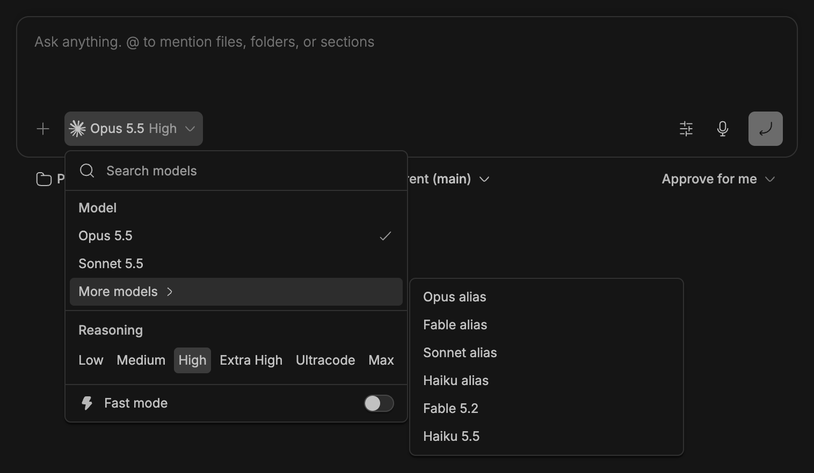
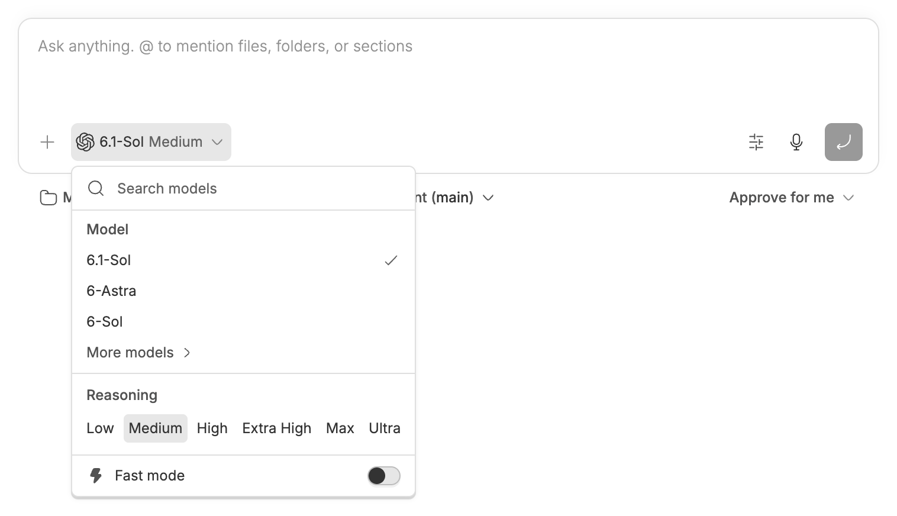
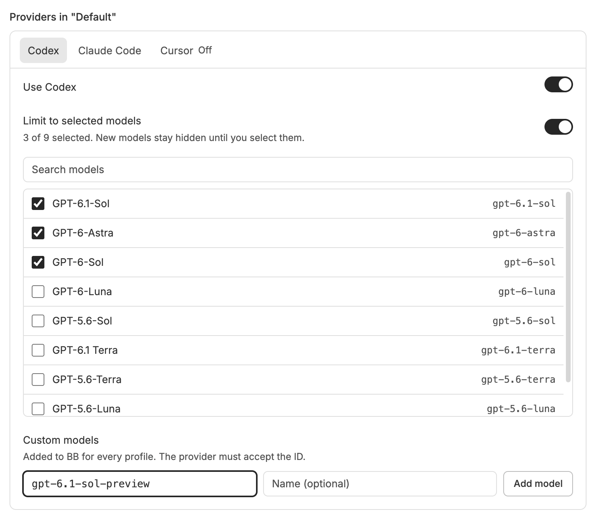
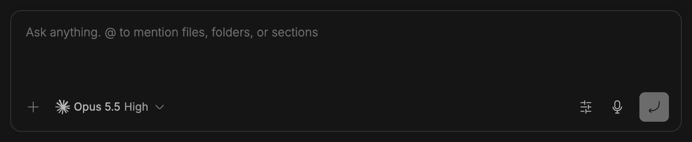

# Profiles

[](https://github.com/ysskrishna/bb-profiles/actions/workflows/ci.yml)
[](https://github.com/ysskrishna/bb-profiles/releases)
[](https://getbb.app/marketplace/bb-profiles)
[](LICENSE)
[](https://ysskrishna.space)

A [BB](https://getbb.app) plugin that chooses which providers and models appear in the model picker for each project, and the default model new threads start on. Settings are shared by every device connected to the same BB server.



The GIF records actual interactions in BB 0.50.1 with disposable demo projects: **Payments service (Claude only) → switch to Mobile app (Codex only) → Profiles settings**. [Capture details](docs/screenshots/README.md).

## Features

| Feature | What it does |
| --- | --- |
| **Profiles** | Default always exists and covers every project without a profile. Create a profile by copying another, then assign projects to it; a project belongs to one profile at most. Duplicate, rename and delete are in the profile's menu (Default can only be duplicated). Deleting a profile returns its projects to Default. |
| **Default model** | A profile can name one provider, model and reasoning level. Opening a new-thread composer in one of its projects selects it, and switching project selects the new project's default. A model you pick in that draft is not overwritten, and the standard service tier is always used. |
| **Providers in a profile** | Turn a provider off to remove it from the picker, or limit it to selected models. New models stay hidden until you select them. The last selected model cannot be unchecked. Saved model IDs BB no longer lists appear under Unavailable and can be removed. |
| **Custom models** | Add a model ID BB does not list (for example `grok-4.7`) with an optional name, or remove one you added. Custom models apply to every profile, and the provider must accept the ID. When the profile limits that provider, the new model is also selected there. |
| **Hidden models** | Unselected models are shown under More models, or removed from the picker. |
| **Composer button** | A sliders button in the new-thread composer opens the settings page. |

Every change saves on its own. Reset everything removes all profiles and rules.

| Settings | Picker for a Claude-only project |
| --- | --- |
|  |  |

<details>
<summary><b>More screenshots</b></summary>

| | |
| --- | --- |
|  |  |
|  |  |
|  | |

</details>

## Limitations

- **Picker filtering only.** CLI and API requests, saved automations, tasks, workflows and other plugins can still request any model. A thread's current model, and its provider, stay selectable even when hidden.
- **Defaults apply to new-thread composers only.** There is no fallback routing, and existing threads are not switched.
- **Custom models are written to BB's config file.** BB has no plugin API for `customModels`, so Profiles edits the top-level `customModels` list in `<dataDir>/config.json` directly: other keys and entries are kept, the write is atomic, and BB's config is reloaded afterwards. An unparseable file is refused and never overwritten. Custom models are global, not per profile, and an ACP agent may still reject an unknown ID when a thread starts. Removing one leaves it under Unavailable in profiles that selected it.
- **Version-specific adapter.** Settings, storage, RPC and the composer action use public APIs. Picker filtering also reads BB's query client through React internals, and the settings button navigates by pushing the settings route because BB has no API for that. A future BB change can break either. When the query client cannot be found, the settings page says so and BB's native lists stay as they are. Do not run it alongside another model-filtering plugin.
- Independent BB servers do not synchronize profiles. Use `bb profiles export` and `import` to move them.

## Installation

Requires **BB 0.50.1 or later**. The release badge above reflects published GitHub Releases.

Install from [BB Marketplace](https://getbb.app/marketplace/bb-profiles):

```sh
bb plugin install bb-profiles
```

<details>
<summary><b>Install a specific release from GitHub</b></summary>

Install the stable release from [Releases](https://github.com/ysskrishna/bb-profiles/releases).

```sh
bb plugin install git:github.com/ysskrishna/bb-profiles@v0.1.1
```

</details>

BB shows the source for confirmation before installing it. The plugin ID is `bb-profiles`. Open **Settings > Profiles** or click the sliders button in a new-thread composer.

<details>
<summary><b>Track development</b></summary>

```sh
bb plugin install git:github.com/ysskrishna/bb-profiles@main
```

</details>

## CLI

```sh
bb profiles status --json
bb profiles reset
bb profiles export > profiles-backup.json
bb profiles import profiles-backup.json
bb profiles models list --json
bb profiles models add acp-cursor grok-4.7 Grok 4.7
bb profiles models remove acp-cursor grok-4.7
```

`status` lists profiles, their projects, provider rules, default models and the hidden-models mode. `reset` removes every profile and rule. `export` prints the whole snapshot as JSON; `import` validates a file the same way, replaces every profile and rule with it, and updates open windows. `models` lists, adds (with an optional display name) or removes custom model IDs; `add` refuses an ID BB already lists or that is already custom. Everything but `export` accepts `--json`. Edit profiles in the settings page.

## Development

<details>
<summary><b>Build and check</b></summary>

```sh
git clone https://github.com/ysskrishna/bb-profiles.git
cd bb-profiles
npm ci
npm run check
```

The [development guide](docs/development.md) covers trying a build in BB. Tag-based releases follow [AGENTS.md](AGENTS.md#tag-based-releases).

</details>

## Project links

- [Releases](https://github.com/ysskrishna/bb-profiles/releases) and [issues](https://github.com/ysskrishna/bb-profiles/issues)
- [Security policy](SECURITY.md)
- [BB Marketplace](https://getbb.app/marketplace/bb-profiles) and [listing maintenance](docs/marketplace.md)

## Built and maintained by

Profiles is built and maintained by:

| | Name | GitHub | Role |
| --- | --- | --- | --- |
|  | **Y. Siva Sai Krishna** | [@ysskrishna](https://github.com/ysskrishna) | Creator |

## Changelog

See [CHANGELOG](CHANGELOG.md) for release history and unreleased changes.

## Support

If you find this project helpful:

- ⭐ Star the repository
- 🐛 [Report issues](https://github.com/ysskrishna/bb-profiles/issues)
- 🔀 Submit pull requests
- 💝 [Sponsor on GitHub](https://github.com/sponsors/ysskrishna)

## License

MIT © [Y. Siva Sai Krishna](https://github.com/ysskrishna) - see [LICENSE](LICENSE) for details.

---

<p align="left">
  <a href="https://github.com/ysskrishna">Author's GitHub</a> •
  <a href="https://linkedin.com/in/ysskrishna">Author's LinkedIn</a> •
  <a href="https://ysskrishna.space">Author's site</a> •
  <a href="https://github.com/ysskrishna/bb-profiles/releases">Releases</a> •
  <a href="https://github.com/ysskrishna/bb-profiles/issues">Report Issues</a>
</p>
